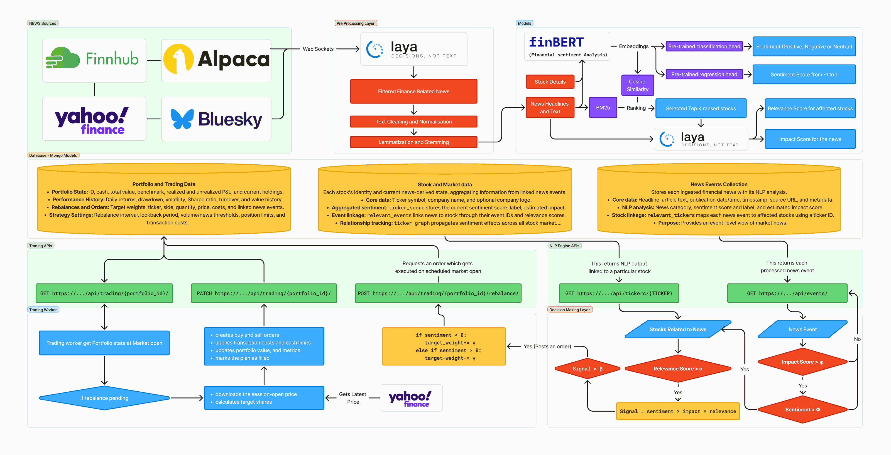
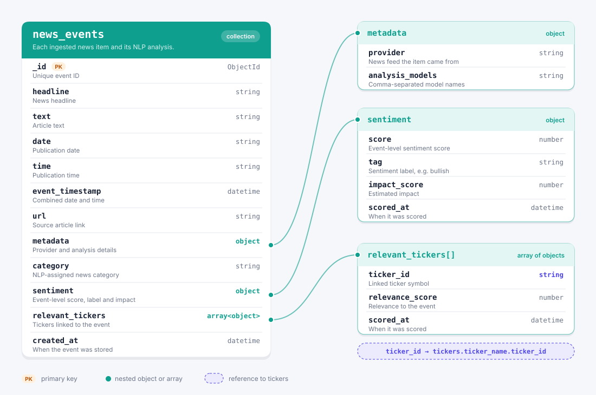
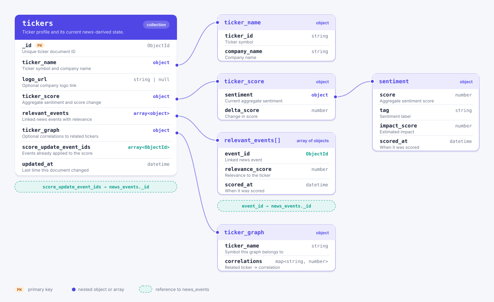
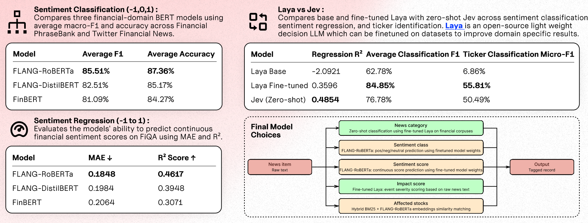

## S&P Global & Crisil Campus Hackathon

- **Candidate Name:** Arjun Verma
- **College Email ID:** arjun.verma@iitg.ac.in
- **College / Campus:** IIT Guwahati
- **Demo Video Link:** https://youtu.be/BUGOn1c1ShQ
- **Website Link:** [https://hackathon-financial-nlp-csp.pages.dev/news](https://hackathon-financial-nlp-csp.pages.dev/news) (live until 6th Nov)
- **Slide Deck Link (if hosted externally):** [presentation.pdf](https://drive.google.com/file/d/1nbPnODLzC-eAg-KrWiNoPMgi9IRhVkFS/view?usp=sharing)

## 1. Project Overview / Problem Statement & Approach

Financial news arrives from multiple sources (Yahoo finance, Finnub, Alpaca news, Bluesky), refers to companies in inconsistent ways, and can affect investment decisions differently depending on the news category and portfolio context. The project demonstrates an end-to-end workflow that collects news relevant to S&P 100 companies, associates articles with candidate tickers, analyzes financial sentiment and impact, and presents the results alongside simulated portfolio activity.

The system combines task-specific FLANG-RoBERTa models with Decision LLMs like Jev and Open source model [Laya](https://github.com/NandhaKishorM/laya) for flexible category, impact, and regression analysis. Incoming articles are queued for analysis and an analysis worker keeps processing queued articles. An interactive React dashboard exposes analyzed news, ticker information, portfolio activity, and paper-trading results via two API endpoints exposed by the NLP Engine.

## 2. Architecture & Tech Stack

### System design and data flow



### MongoDB document schemas

The MongoDB documents used by the application are illustrated below.

#### News events



#### Tickers



### Key frameworks, databases, and AI/ML libraries

- **Frontend:** React 18, Vite 5, JavaScript.
- **Backend:** Python 3.11, Django 5.1, Gunicorn, Django REST endpoints.
- **Data and cache:** MongoDB 7 for news, tickers, and paper-trading state; Redis 7 for caching.
- **Analysis:** PyTorch, Hugging Face Transformers, FLANG-RoBERTa, FLANG-Laya, KaggleHub for storing models (https://www.kaggle.com/arjunverma14142/models), and optional Jev API access.
- **News and market data:** [Finnhub](https://finnhub.io/dashboard), [Alpaca News](https://app.alpaca.markets/), [Bluesky](https://bsky.app/), and [Yahoo Finance](https://finance.yahoo.com/).
- **Runtime and deployment:** Docker Compose. Production uses Caddy for HTTPS and Cloudflare Pages for the frontend, Oracle Cloud (Free Tier) for VM/Backend.

## 3. Dataset Used

The live prototype can ingest public financial news from Finnhub, Yahoo, Alpaca, as well as posts from Bluesky. Finance related news from Bluesky are filtered using Laya. The repository also contains a MongoDB seed archive with example news, ticker records, and paper-portfolio history so a fresh local deployment starts with populated dashboard data. Data availability and fields depend on the upstream provider.

For model experiments and fine-tuning regression and classifications heads and Laya, the notebooks use these publicly available benchmark datasets:

| Dataset | Approximate rows | Task |
|---|---:|---|
| Financial PhraseBank | 4,846 in the 50% agreement file; other files are overlapping agreement subsets | Financial sentiment classification |
| FiQA 2018 | 1,213 | Financial sentiment regression |
| Twitter Financial News Sentiment | 11,931 | Financial sentiment classification |
| Financial News ticker/entity linking | 70,974 | Multi-label ticker association |

The benchmark files are under `data/benchmarks/`. Install Git LFS and run `git lfs pull` if you need the full files for notebook work; the website does not need them. PhraseBank files are overlapping subsets and should not be combined in one evaluation. Dataset labels are source annotations and may not be independently adjudicated. See [`data/README.md`](data/README.md) for details.

## 4. Quickstart & Installation

**Runtime:** Docker Desktop with Docker Compose; the backend image uses Python 3.11 and the frontend build uses Node.js 22. The included PowerShell launcher is for Windows.  
**Locally verified:** Windows with Docker Desktop. macOS can use Docker Desktop and the same Docker Compose workflow.

### Run locally

1. Clone the repository and enter its folder:

   ```bash
   git clone https://github.com/who-else-but-arjun/IIT-Guwahati-Arjun-Verma-Hackathon.git
   cd IIT-Guwahati-Arjun-Verma-Hackathon
   ```

2. No `.env` file is required to reproduce the local demo. Finnhub and Alpaca credentials are configured in `src/backend/constants.py`. Jev analysis is optional: without `OPENCODE_API_KEY`, the processor uses FLANG-Laya for category and impact feedback. Get key here https://opencode.ai/console/ - Jev-1.13-free is free to use.

3. Start the stack from the repository folder:

   ```bash
   docker compose up --build -d
   ```

   On Windows, you can also run `.\scripts\start.ps1` in PowerShell.

   > **Note:** The first `--build` takes 3–5 minutes — it downloads the Python base image, installs PyTorch CPU wheels (~200 MB), and installs remaining dependencies. 

   **First-run initialization:** When the stack starts, an `init` service runs automatically before the backend, trading, and news services. It performs three steps in sequence:
   1. **Cleans up corrupted model caches** — removes any incomplete KaggleHub model downloads from the shared `model_store` volume.
   2. **Seeds tickers** — ensures all 101 S&P 100 companies have a MongoDB document.
   3. **Initializes comparison portfolios** — runs `scripts/initialize_live_portfolios.py`, which replays a 5-year backtest from the seed data, creates the "Normal Rebalancing" and "News Sentiment + Normal Rebalancing" paper portfolios, fetches and analyzes historical news, and replays the final month for both portfolios.

   **This first-run initialization typically takes 5-10 minutes** because it must download FLANG-RoBERTa model weights from KaggleHub (~500 MB per model), fetch 5 years of price data from Yahoo Finance, and run the backtest simulation. When `OPENCODE_API_KEY` is not set, Jev is unavailable and each of the 300 historical news events must be analyzed with FLANG-Laya, which can extend the first-run to 2–4 hours. The backend and trading API will not become healthy until the init service completes successfully. You can monitor progress with:

   ```bash
   docker compose logs -f init
   ```

   **macOS setup:** Install Docker Desktop for Mac, open it, and wait until Docker reports that the engine is running. Then open Terminal, run the clone commands above, and start the stack with `docker compose up --build -d`. No `.env` file is required. Open <http://localhost:5173> when the containers are ready. To stop the app, run `docker compose down` from the repository folder.

   If the init service fails (e.g., KaggleHub is unreachable or rate-limits model downloads), delete the `model_store` volume and retry: `docker compose down -v && docker compose up --build -d`. Note this also clears the Mongo and Redis data volumes, so MongoDB will restore the seed archive on the next start.

4. Open the dashboard at <http://localhost:5173>. The news API is at <http://localhost:8000>; the trading API is at <http://localhost:8001/api/trading/>. The included seed archive is restored automatically when MongoDB initializes a new empty data volume.

5. Check services and logs:

   ```bash
   docker compose ps
   docker compose logs -f trading news-analysis-worker finnhub-poller alpaca-news bluesky-news
   ```

   Stop the stack with `docker compose down`. This keeps the database volumes. **Do not use `docker compose down -v` if you want to retain local MongoDB and Redis data.**

### Model and provider notes

Full analysis requires the published model artifacts to be reachable through KaggleHub and successfully loaded. Models were fine-tuned and uplaoded to KaggleHub with Public access. During runtime the Virtual Machine loads these models once. External news feeds and market prices also depend on provider access and network availability. The seeded database (not synthetic) allows the dashboard to show example data without waiting for new provider articles.

### Production deployment

The production stack uses Caddy on ports 80/443, keeps APIs and databases private, and persists MongoDB, Redis, and model downloads in Docker volumes.

1. On a Linux VM, clone the repository and create `.env` from `.env.example`. Set a strong `DJANGO_SECRET_KEY`, `API_HOSTNAME`, and the required provider credentials. Set `DJANGO_ALLOWED_HOSTS` to the API hostname, `CORS_ALLOWED_ORIGINS` to the exact HTTPS Cloudflare Pages origin, and `CSRF_TRUSTED_ORIGINS` to the HTTPS origins.
2. Point the API hostname to the VM. Allow SSH only from your IP, and allow public inbound HTTP/HTTPS on ports 80 and 443. Do not expose MongoDB, Redis, or the Django API ports publicly.
3. Start the server stack:

   ```bash
   docker compose -f docker-compose.production.yml up -d --build
   ```

4. In Cloudflare Pages, connect this repository with root directory `src/frontend`, build command `npm run build`, and output directory `dist`. Set `VITE_API_URL` and `VITE_TRADING_API_URL` to `https://YOUR_API_HOSTNAME`, then deploy.
5. Verify `https://YOUR_API_HOSTNAME/api/health/` and `https://YOUR_API_HOSTNAME/api/trading/health/`, then inspect worker logs:

   ```bash
   docker compose -f docker-compose.production.yml ps
   docker compose -f docker-compose.production.yml logs --tail=100 trading news-analysis-worker finnhub-poller alpaca-news bluesky-news
   ```

MongoDB restores the seed archive only when it initializes a new empty data volume. Existing databases persist on restart; never run `docker compose down -v` on a database you need to retain. Keep the server `.env` private.

## 5. Key Results & Domain Impact

The prototype demonstrates a complete path from incoming financial news to ticker-aware analysis, a browsable dashboard, and simulated portfolio responses. Persisting articles in a queue before analysis prevents temporary model or provider failures from silently discarding news; the worker retries pending items in queue when processing becomes available. The paper-trading engine demonstrates how analyzed news can be connected to portfolio state without placing real trades.

Saved notebook evaluations report the following results. These are offline benchmark results; they do not represent live production accuracy, and runs with different sample sizes or methods should not be compared as a controlled head-to-head test.

The business value is a reviewable prototype for organizing financial news by company and sentiment, surfacing candidate ticker relevance, and exploring possible portfolio effects using simulated trades. Human review and broader, consistently split evaluation are needed before using the outputs for investment decisions.


---

For implementation details, evaluation tables, and data provenance, see [`notebooks/final/README.md`](notebooks/final/README.md) and [`data/README.md`](data/README.md).
